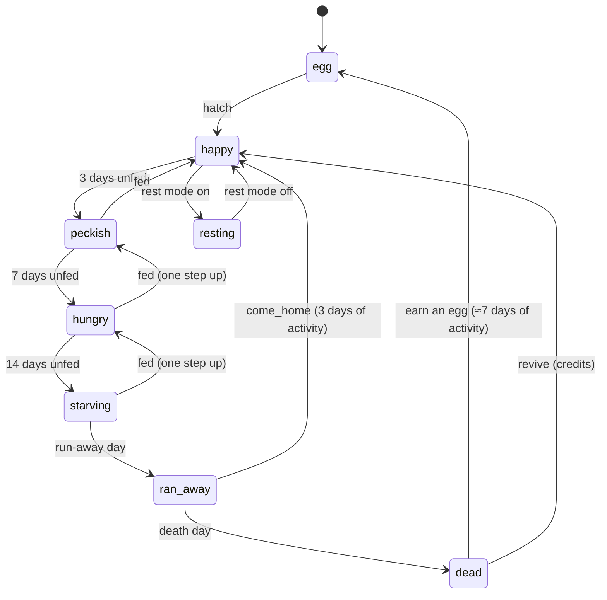

# Pet state machine

The contract between the app and the pet model. Build the model (Spline or Rive) to these states, animations and inputs; the app drives it by setting the inputs below. Source of truth for behaviour is [Project Breakdown.md](Project%20Breakdown.md) → §10 The Pet and §11 Living Interface.

The pet runs **three layers at once**:

1. **Life** — long-lived, from the database (hunger, ran away, dead, resting, egg). Decides what's possible.
2. **Activity** — what it's doing right now (idle, walking, sleeping, eating…). Loops until something changes it.
3. **Reactions** — short one-shots on top (a nod, a hop, a sniff). Play, then return to the activity.

Plus **modifiers** that change how things look without changing state: species/breed, sliders, accessories, weather, time of day, liveliness, reduced motion.

---

## 1. Life layer

Computed by the app from `last_fed_at`, the user's timeline (`runaway_days`, `death_days`) and `rest_until`. The model only needs to know which one is active.

| Life state | When (default timeline)                                   | Look                                                    | Allowed activities                                                    |
| ---------- | --------------------------------------------------------- | ------------------------------------------------------- | --------------------------------------------------------------------- |
| `egg`      | New pet before hatching, or earning a new one after death | Egg, wobbles when the user does work                    | `egg_idle`, reaction `egg_wobble`, one-shot `hatch`                   |
| `happy`    | 0–2 days since last feed                                  | Bright, energetic idle                                  | all                                                                   |
| `peckish`  | 3–6 days                                                  | Slightly slower idle, glances at the bowl               | all                                                                   |
| `hungry`   | 7–13 days                                                 | Droopy idle, tummy rumble, sits by the bowl             | all, slower                                                           |
| `starving` | 14 days → run-away day                                    | Weak, lying down, minimal movement                      | `idle_weak`, `eat`, `sleep`; reactions limited to `look`, `purr_weak` |
| `resting`  | Rest mode on                                              | Curled up with a "resting" prop (blanket, sign)         | `sleep`; wakes only for `click`                                       |
| `ran_away` | Run-away day → death day                                  | **Pet absent**: empty bed, pawprints                    | none (room only). One-shot `come_home` when it returns                |
| `dead`     | Death day onward                                          | Skeleton/bones in the bed, then a memorial on the shelf | none. One-shot `die` on the transition                                |

Hunger also drives the **living interface** (dust, cobwebs, scraps), which is the room's job, not the pet's.

## 2. Activity layer

One at a time. Higher priority wins; when it ends, fall back to `idle` (or `walk`).

| Priority | Activity  | Loop?                                                    | Triggered by                                                               | Ends when                            |
| -------- | --------- | -------------------------------------------------------- | -------------------------------------------------------------------------- | ------------------------------------ |
| 1        | `dragged` | loop (wriggle)                                           | `dragStart`                                                                | `dragEnd` → reaction `land`          |
| 2        | `sleep`   | loop (breathing, purr/snore sound)                       | `isFocusSession` true, or `isNight` + `liveliness` calm, or life `resting` | focus ends → reaction `wake_stretch` |
| 3        | `eat`     | one-shot (2–3 s)                                         | `feedSnack` / `feedMeal` / `feedFeast`                                     | done → reaction by size              |
| 4        | `play`    | loop (with equipped toy)                                 | `isBreak` true                                                             | break ends                           |
| 5        | `talk`    | loop (mouth/gesture while a speech bubble shows)         | `talkStart`                                                                | `talkEnd`                            |
| 6        | `read`    | loop (sits beside the text, head follows)                | `isTyping` true (journal)                                                  | typing stops for ~5 s                |
| 7        | `walk`    | loop                                                     | roaming: random every 20–60 s (scaled by liveliness)                       | reaches target                       |
| 8        | `bored`   | one-shot                                                 | idle > 2 min                                                               | done → `idle`                        |
| 9        | `idle`    | loop (variant per life state: happy/peckish/hungry/weak) | default                                                                    | —                                    |
| —        | `hidden`  | none                                                     | `isMinimized` true                                                         | un-minimized                         |

`sleep` beats everything except `dragged`: during a pomodoro the pet stays asleep and food waits until the session ends.

## 3. Reactions (one-shots)

Play over the current activity (or briefly replace `idle`/`walk`), then return. Ignored while `sleep` (except `wake_stretch`), `hidden`, `ran_away`, `dead`.

| Reaction        | Trigger                                                  | Notes                                                                         |
| --------------- | -------------------------------------------------------- | ----------------------------------------------------------------------------- |
| `look`          | `cursorNear` (number input: direction)                   | Head/eyes follow; ears perk. Continuous blend, not a clip                     |
| `pet_react`     | `click`                                                  | Species variant: purr (cat), wag (dog), rumble (monster), smoke puff (dragon) |
| `land`          | `dragEnd`                                                | Small bounce                                                                  |
| `hop`           | `stepDone`, `feedMeal`                                   | Happy hop                                                                     |
| `celebrate`     | `feedFeast` (item finished)                              | Bigger party move                                                             |
| `nibble`        | `feedSnack`                                              | Small chew + satisfied look                                                   |
| `nod`           | `reviewGotIt`                                            | Approving nod / thumbs up gesture                                             |
| `sniff`         | `newCapture`                                             | Walks to and sniffs the new card                                              |
| `wake_stretch`  | focus session ends                                       | Yawn + stretch, then `play` if a break starts                                 |
| `run_to_screen` | `returnAfterGap`                                         | Runs toward the viewer; the room plays its sweep-clean                        |
| `sleepy`        | `isNight` turns true                                     | Yawn, droopy eyes; suggests stopping                                          |
| `sad`           | `missedBlock`, or idle variant while `hungry`/`starving` | Short sigh                                                                    |
| `egg_wobble`    | any feed while `egg`                                     | Egg rocks                                                                     |
| `hatch`         | life `egg` → `happy`                                     | Long one-shot (3–5 s)                                                         |
| `come_home`     | life `ran_away` → `happy`                                | Walks in, reunion                                                             |
| `die`           | life → `dead`                                            | Collapse/fade to skeleton. Keep it gentle                                     |
| `shake_off`     | weather rain ends                                        | Shakes off water                                                              |

## 4. Weather and time of day (modifiers)

Inputs: `weather` (number enum), `isNight`, `season`. Mostly props and idle variants, not new states.

| Weather / time | Pet does                                                                |
| -------------- | ----------------------------------------------------------------------- |
| `rain`         | Raincoat prop; puddle splash on `walk`; `shake_off` when it stops       |
| `thunder`      | Hides under the bed (replaces `idle`), peeks out on `click`             |
| `sun`          | Sunbathing idle variant                                                 |
| `snow`         | Snow on fur; during `play` builds a snowman                             |
| `fog` / `wind` | Fur and accessories sway (physics, not a clip)                          |
| `night`        | Room darkens; `sleepy` reaction; sleep more often if liveliness is calm |

## 5. Inputs the app sets

Name these exactly in the model so the app can drive it (Rive state machine inputs, or Spline events/variables).

**Numbers**

- `lifeState` — 0 egg · 1 happy · 2 peckish · 3 hungry · 4 starving · 5 resting · 6 ran_away · 7 dead
- `liveliness` — 0 calm · 1 normal · 2 chaotic (scales roam frequency and reaction size)
- `growth` — 0–100 (body size / growth stage blend)
- `weather` — 0 clear · 1 sun · 2 rain · 3 thunder · 4 snow · 5 fog · 6 wind
- `lookX`, `lookY` — -1…1, cursor direction for `look`
- Sliders (body): `fluffy` 0–100, `furLength`, `size`, `hue`, `pattern`, `eyes`, `horns`

**Booleans**

- `isFocusSession`, `isBreak`, `isTyping`, `isNight`, `isMinimized`, `reducedMotion`, `talking`

**Triggers**

- `feedSnack`, `feedMeal`, `feedFeast`, `click`, `dragStart`, `dragEnd`, `stepDone`, `reviewGotIt`, `newCapture`, `returnAfterGap`, `missedBlock`, `talkStart`, `talkEnd`, `hatch`, `comeHome`, `die`

`reducedMotion` true: hold a calm pose per state, swap poses instead of animating, no roaming.

## 6. Animation checklist (per species)

Build once per species (dog, cat, fluffy monster, dragon; bears later). Breeds reuse the rig with different fur, shape and the `pet_react` sound.

**Loops (11):** `idle_happy`, `idle_peckish`, `idle_hungry`, `idle_weak`, `walk`, `sleep`, `play`, `read`, `talk`, `dragged`, `egg_idle`

**One-shots (17):** `eat`, `land`, `hop`, `celebrate`, `nibble`, `nod`, `sniff`, `pet_react`, `wake_stretch`, `run_to_screen`, `sleepy`, `sad`, `bored`, `egg_wobble`, `hatch`, `come_home`, `die`

**Props / variants:** raincoat, hide-under-bed, sunbathe, snowman, shake_off, resting blanket, skeleton/memorial, food per species (cookies, bones, fish, meat, embers)

**Attachment points** (all species, same names): `head`, `face`, `neck`, `back`, `hand`. Accessories snap here and must follow every animation above.

**Light render** (low-power phones, extension): one static or looping sprite per life state + `sleep`, `eat`, `hop`.
